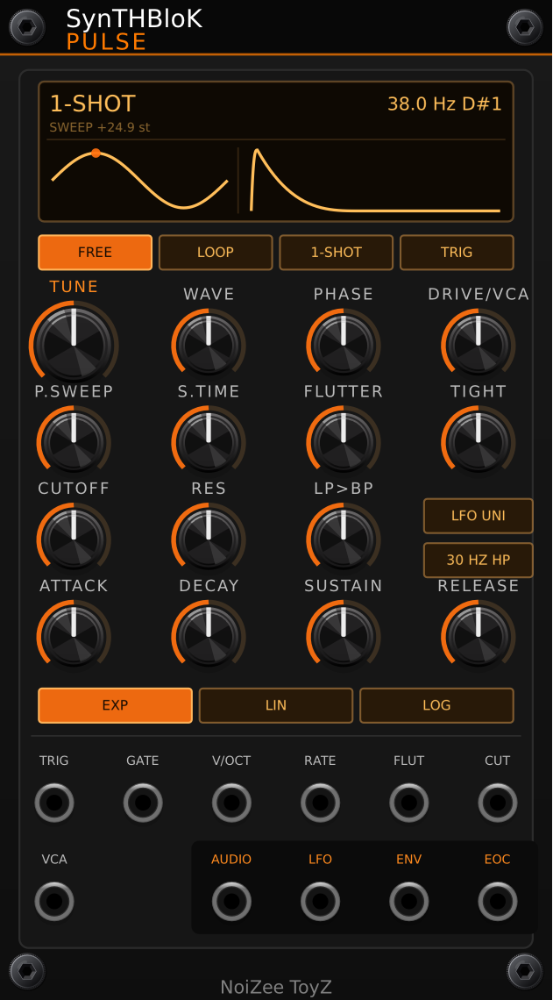

# SynTHBloK PULSE

A free VCV Rack 2 plugin by **NoiZee ToyZ** (part of the SynTHBloK series).



| Module | What it does |
|---|---|
| **PULSE** | Triggerable LFO / VCA voice: one oscillator from 0.01 Hz to audio with wave morph, start phase, pitch sweep, looping ADSR, LP / BP filter, drive and tape flutter; FREE / LOOP / 1-SHOT for sub kicks, flutter bass, pads and slow modulation |

## Install

In VCV Rack 2: **Library**, search **SynTHBloK PULSE**, **Add**.

## Build

```
make RACK_DIR=/path/to/Rack-SDK   # or: make dist / make install
```

## Licence

GPL-3.0-or-later (see `LICENSE.txt`). The SynTHBloK and NoiZee ToyZ names and logos are not covered by the licence.
